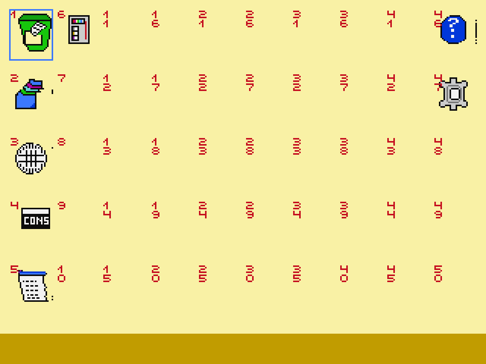

# MCWCOS
Multi-compatible Console Windows Cover Operational System
--------------------------------------------------------


## What this application is
This app is a custom Windows shell that acts as a desktop environment. It is written in C++ and uses the `windows.h` API to set the window bounds and apply the smallest possible console font (2x2 pixels, as 1x1 leads to layout glitches).

Instead of relying on slow standard console output methods, the system utilizes a high-performance rendering engine built around the native `WriteConsoleOutputW()` API. It writes raw pixel data directly into a global screen buffer (`CHAR_INFO`), allowing the UI to render instantly. In this architecture, the character 'A' acts as a solid pseudo-pixel block. Custom render helpers (`printSpecialA`) handle positioning and color drawing, while fast buffer flushing is managed via the `endPrintA` header file.

## Current Progress
1. Instantly renders the modular desktop interface.
2. Includes a smart OS detector targeting Windows 11-specific DWM (Desktop Window Manager) behavior to ensure clean window closure.
3. Features shortcut handling (e.g., the `Escape` key exits the app, safely terminates the custom process layer, and restores the standard Windows desktop environment).
4. Opens basic system apps (e.g. Notepad, Control Panel)
5. While AI assisted with specific implementation details, the overall architecture, concept, and core logic were independently designed and developed.

## System Requirements & How to Run
* **System Requirements:** Windows 95 up to Windows 11 (32-bit and 64-bit; compatibility with versions older than Win95 is untested).
* **Prerequisites:** A C++98-compatible compiler (such as MinGW / G++ 4.6 or newer, e.g., via Dev-C++).

### How to Run:
1. Download a precompiled `.zip` archive from the **Releases** tab, or clone/download the repository into a non-restricted folder (e.g., `D:\MCWCOS\` or your Desktop).
2. If compiling from source, build `sys.cpp` using the C++98 standard and static linking (so the `.exe` runs standalone without external `.dll` files):
   ```cmd
   g++ -std=c++98 "sys.cpp" -o "MCWCOS.exe" -static-libgcc -static-libstdc++ -s "-Wl,--subsystem,console:4.0" -lgdi32
   ```
3. Run `MCWCOS.exe`:
   * **Windows 95 – Windows Vista / 7:** Runs directly as a standard user (no administrator privileges required).
   * **Windows 10 / 11:** Run via classic `conhost.exe` (Windows Console Host) rather than Windows Terminal for full font-scaling support.


## Troubleshooting (Compiler Issues)
If you encounter issues while compiling the project, check the solutions below:

### 1. 'g++' is not recognized as an internal or external command
* **Cause:** The GCC/MinGW compiler is not installed, or its path is not added to the system Environment Variables (PATH).
* **Solution:** Download and install MinGW. Then, add the `bin` folder path (e.g., `C:\MinGW\bin`) to your Windows PATH environment variables. Restart your terminal (cmd) and try again.

### 2. Access Denied (Permission Error)
* **Cause:** The output file (`.exe`) might still be running in the background, or the folder is locked by another process (like `conhost.exe`).
* **Solution:** Close all open console windows, or open Task Manager (`Ctrl + Shift + Esc`) and terminate any active `MCWCOS.exe` or `Console Window Host` processes.

### 3. No such file or directory
* **Cause:** The compiler cannot find your source file at the specified path.
* **Solution:** Make sure you are using quotes `""` for paths with spaces. Double-check your absolute path layout (e.g., `C:/MyOS/MCWCOS/sys.cpp`).

## Important Rules for the Project Directory
If you install this program to use it (and not to edit the source code), please follow these rules:
* **Do not change** file or folder names.
* **Do not delete** files or folders, except for the test folders (they do nothing and contain legacy/abandoned font experiments).
* **Do not move** files or folders.
* **Do not edit** the source code directly.

Breaking the first three rules will break the program. Breaking the fourth rule will cause undefined behavior.

